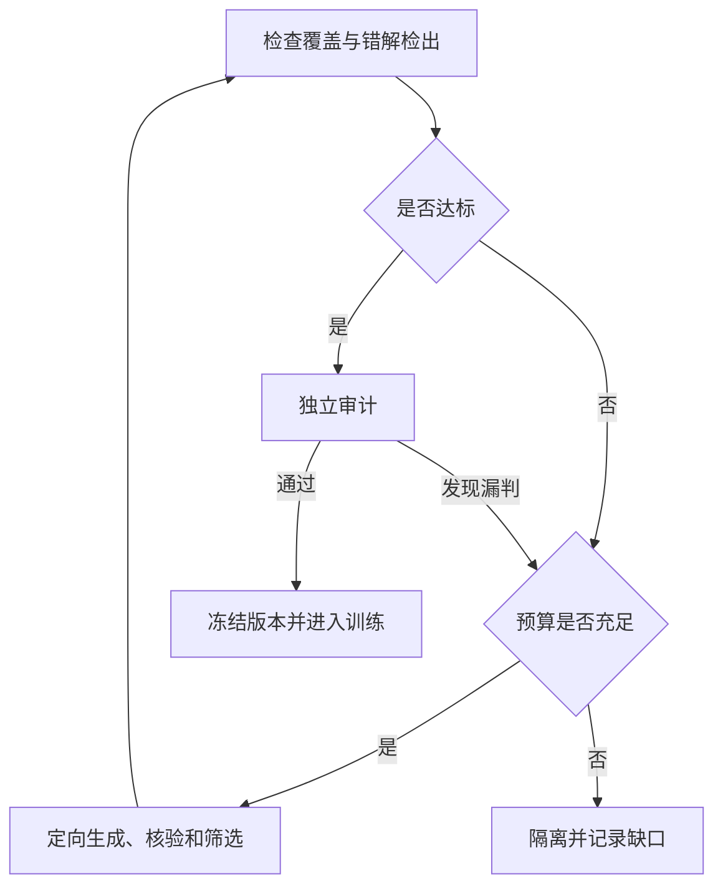

# 测试扩容方案 v1：覆盖、判定质量与成本（2026-11-09 收录）

**用途：** 回答「每道题用于计算奖励的测试样例够不够、缺口怎么补、投入是否值得」的工业化方案。面向 Code-R1 的 LeetCode 训练题（先 7 道示范题试点，200 道评测题单独管理），是补强项 2、3（变异审计、oracle 补测试）的规模化延伸，也是[专题索引·专题三](专题索引_任务构造与沙箱.md#topic-oracle)的执行方案。定案登记见[设计定案表 D13](设计定案表.md)。

**核对与落地状态（2026-11-09，收录时逐条对仓库现状核过）：**

| 项 | 状态 |
|---|---|
| §8 判分归因修正（大输入答错 ≠ 性能瑕疵） | **已落地**：`coder1_plus/__init__.py` 与 `perf.py` 改为——超时=性能瑕疵 0.9；大输入输出不符/出错=正确性失败 0.1（`failed_perf_mismatch`）；`verify_perf_round.py` 18/18（新增对照：小输入全对、大输入答错的构造解 → 0.1）。00/02 档位表、定案表 D4 同步 |
| §2 「13 条测试仍放过错误初始化程序」 | **与仓库现状不符，已核对**：重建现行 13 条（3 seed + 10 条 oracle 接受）GT 实测，三个典型错误初始化变体全部 0.1 被拒（追加的全负用例抓住它们）；被放过的是**扩容前的 3 条 seed 时期**（seed 答案全正，实测 ans=0 变体拿 1.1）。方案此句应读作「seed 时期的教训」，不是现行状态 |
| §1–§7、§9（覆盖清单、指标三组、分级预算、闭环、核验筛选、独立审计、成本、阶段 A–D） | **方案收录，阶段 A 待实施**；实施位置按 §9 的职责表（`coder1_plus_tests.py`、`coder1_plus_oracles.py`、`verify_test_quality.py`、`coder1_plus.py`、`perf.py`） |
| 依赖关系 | 错解池的变异母体需要参考解——与 D12（补强项 11 的参考解获取与过滤）衔接：进池的题都有社区参考解 |
| D13 补参（2026-11-13） | **已定参、待阶段 A 实施核对**：correctness 轮随机输入长度上限 1000；入 GT accepted 目标 10~30 条 + perf 轮 1 条（40-80/200/1000 仍为候选池口径）；新增「扩容不达标告警」（取数点在幂识别**之前**：原生解析 `bound_raw` 对账，`< 1000 且难度 ≥ medium` 计数——上标类约束缺陷的管线自检信号；生成/判分仍用幂识别值，取修复后的值会因掩盖效应永不触发）。语义边界获取方式同步修订为「错解反推按需补」（D17 修订）。见[设计定案表](设计定案表.md) D13 补参 / D17 修订、[讨论结论库第 11 条](讨论结论库.md#lib-two-rounds-cost) |

---

## 方案原文（v1，2026-11-09）

这版方案面向 **Code-R1 中每道题用于计算奖励的测试样例**，同时解决三个问题：**覆盖是否充分、缺口怎么补、投入是否值得。**

基于已经检查的仓库版本，先处理 LeetCode 部分的 **1,890 道训练题**。现有 7 道示范题作为试点；200 道评测题单独管理，不用于指导训练测试扩容。下面的数量和耗时上限是 **v1 试点预算**，不是"达到这个数量就一定充分"的保证。

**1. 每道题先定义覆盖清单，才能衡量覆盖率。**

为每道题建立一份简短的测试规格：

| 内容 | 需要记录什么 | 最大子数组示例 |
|---|---|---|
| 题意要求 | 程序必须满足的语义 | 非空、连续、返回最大和 |
| 输入约束 | 类型、长度、值域和结构限制 | 长度 1～10⁵，元素 −10⁴～10⁴ |
| 关键边界 | 最小值、最大值、临界值、特殊结构 | 单元素、全负、全零、数值上下界 |
| 高风险组合 | 容易共同触发错误的条件 | 全负×大规模、最优答案位于末尾×大规模 |
| 典型错误 | 需要识别的错误算法或实现 | 允许空数组、累加所有正数、错误初始化、漏掉最后一个元素 |
| 判定规则 | 如何判断输出正确 | 本题直接比较整数；多解题需要合法性判定器 |
| 性能要求 | 合法规模、资源限制及标定依据 | 在规定规模和执行预算内完成 |

**覆盖清单应先确定，再计算覆盖率。** 不能因为某种边界难生成，就把它从分母里删掉；不适用的项目需要注明理由。

"已覆盖"至少需要对应的合法测试、可信答案和 `case_id`。关键语义还应有反向检错证据，例如"非空"对应一条能拒绝"允许空子数组"程序的测试。

**2. 衡量指标分为覆盖、判定质量和成本三组。**

| 指标 | 定义 | v1 验收要求 |
|---|---|---|
| **题意覆盖率** | 已覆盖的必需语义项 ÷ 全部必需语义项 | 必需项 **100%** |
| **边界覆盖率** | 已覆盖的适用边界项 ÷ 应覆盖边界项 | 必需项 **100%** |
| **关键组合覆盖率** | 已覆盖的高风险组合 ÷ 已登记高风险组合 | 登记项 **100%**，不要求穷举所有组合 |
| **已知错解检出率** | 被拒绝的已确认错解数 ÷ 已确认错解总数 | 开发错解池 **100%**；同时按错误类型统计 |
| **正确解误杀率** | 被拒绝的已确认正确实现数 ÷ 正确实现总数 | 审核样本中 **0 误杀** |
| **独立审计漏判率** | 通过评分测试的已确认错解数 ÷ 独立审计错解总数 | 发现漏判就修补；规模化阶段报告样本量与置信界限 |
| **获奖励程序的复审错误率** | 获得正确性奖励后，被独立审计证实错误的程序数 ÷ 已复审程序数 | 用于检查真实训练中的奖励可靠性 |
| **扩容边际收益** | 每批新增测试多识别了多少个错解、多少种错误类型 | 决定下一批补哪里、是否值得继续 |

注意三点：

- **变异杀死率作为辅助指标。** 已有实验中，最大子数组 9/9 变异体全部被检出，13 条测试仍放过了错误初始化程序，不能用它单独验收。
- **使用正确性判定结果统计，不直接用 `reward == 1.1` 代替。** 奖励还包含格式和性能因素。
- **环境故障、判分器异常、程序自身错误分开记录。** 无效执行不算成功检错，应补足有效审计样本。

"获奖励程序的复审错误率"必须来自真实模型输出；尚未采样时标记为"未测"，不能用手写错解冒充。

**3. 扩容采用分级预算，先补缺口，再扩大搜索。**

| 层级 | 触发条件 | 每题累计候选预算 | 建议累计执行预算 |
|---|---|---:|---:|
| 初筛 | 所有待处理题 | 复用现有测试，检查规格、参考解和少量错解 | 先测量，不展开大规模搜索 |
| 普通补强 | 缺边界或存在容易定位的漏判 | **40～80 条** | **60 执行秒** |
| 定向补强 | 普通补强后仍有存活错解 | **200 条** | **5 执行分钟** |
| 深度补强 | 高风险、复杂语义或反复漏判 | **最多 1,000 条** | **10 执行分钟**，另设人工/API 预算 |

这里"执行时间"按各执行任务耗时累计，便于核算计算资源；并行后的墙钟时间另记。上述预算通过 7 题试点校准。

**预算耗尽但指标未达标，结果是"待补充或隔离"，不能标记为测试充分。**

普通补强以 60 条候选为例，可以这样分配：

| 来源 | 起始配额 | 生成方法 |
|---|---:|---|
| 题意与边界 | 12 条 | 根据规格明确构造 |
| 特殊结构 | 16 条 | 单调、重复、交替、首尾答案、极端不平衡等 |
| 分层随机 | 16 条 | 分别覆盖不同长度、值域与结构 |
| 错解驱动 | 12 条 | 针对存活错解搜索反例 |
| 大规模输入 | 4 组 | 保持题意合法，并覆盖不同结构 |
| **合计** | **60** | 不适用的配额重新分配，先去重 |

大规模输入不能只把数组拉长。排序、唯一性、连通性、树结构等约束也必须保留。

**4. 扩容流程形成一个有预算限制的闭环。**

具体按以下顺序执行：

1. **建立正确程序和错误程序池。** 初筛先用少量程序；普通补强使用约 8～12 个有区别的已确认错解，深度补强再扩到 20～40 个。正确实现尽量保留 2～3 种不同写法。
2. **定位覆盖缺口。** 找出缺少的边界、未覆盖的错误类型，以及仍能通过现有测试的错解。
3. **针对缺口生成输入。** 已知是全负数问题，就优先生成全负输入，而不是继续扩大普通随机样本。
4. **核验合法性与答案。** 合法性检查通过后，用参考解和独立 oracle 核对；有冲突先隔离。
5. **缩小反例并去重。** 尽量把长输入缩成仍能复现错误的短输入，降低判题成本，也方便解释。
6. **挑选贡献高的测试，重新审计。** 观察覆盖和检错是否改善，再决定继续扩容或进入独立验收。

错误程序至少来自两种不同来源，后续逐步补齐三类：

| 来源 | 主要覆盖什么 |
|---|---|
| 参考解局部变异 | 下标、比较符、初始化、循环边界 |
| 语义错误算法 | 题意误解、错误贪心、遗漏条件等 |
| 模型真实输出 | 当前策略实际产生的错误，尤其是通过旧测试的错误 |

**每个程序必须有可信反例，才能标记为"已确认错解"。** 没找到反例的存活变异体保留为"未定"，不能直接认定错误或等价。

**5. 答案核验与测试筛选决定扩容是否有效。**

入库条件统一为：

> 输入合法 ＋ 答案或判定器可信 ＋ 执行有效 ＋ 来源可追溯。

小输入优先使用简单暴力 oracle，并通过小域穷举核对。大输入使用经过交叉验证的高效实现。多解题按合法性和题目要求判定，不能因为输出与参考解不同就判错。

LLM 可以帮助分析错误、编写生成器和 oracle 草稿，但不能仅凭它给出的数字确定 expected。缺少可靠 oracle 的题暂缓扩容。

评分测试集以 **每题 16～32 条为初始容量目标**，复杂题再增加到 64 条或更多。选择时建立"测试输入 × 错误程序"的检出矩阵，优先保留：

- 补齐必需语义、边界和关键组合的测试；
- 能抓住新错误类型的测试；
- 能同时抓住多个错解且执行便宜的测试；
- 历史漏判对应的回归测试；
- 少量结构不同的随机输入。

不能仅凭当前错解池的检出结果，把所有"暂时冗余"的边界样例删掉，因为错解池本身不完整。

**6. 独立审计需要保留，但按阶段投入。**

用于指导扩容的程序和输入属于开发材料。最终验收应使用未参与补强的程序，以及不同生成策略产生的输入。

建议这样分配：

| 范围 | 独立审计投入 |
|---|---|
| 每道准备入池的题 | 少量留出的程序，加 **20～40 条新输入**进行基础复核 |
| 7 道试点题、反复漏判题 | 扩到 **80～200 条新输入**，增加不同错误来源 |
| 100 题及后续批次 | 按题型、难度和风险分层抽样，开展更深审计 |
| 真实训练期间 | 抽查获得正确性奖励的程序，检查策略变化带来的新漏洞 |

这些数量是搜索预算，不是统计保证。规模化阶段若设定"固定审计分布上的漏判率上界低于 1%"，在可信判定、近似独立抽样下，约需 **300 个错解零漏判**才能支持相应的单侧 95% 上界。

这里统计的是**错误程序数量，不是输入测试数量**。同一错误的重复改写不能用于凑独立样本；总体结果也不能掩盖某一题型表现差。

独立审计发现漏判后，将反例加入回归集，再补充新的审计材料。用来修补的材料不再作为独立验收证据。

**7. 时间和成本必须作为验收的一部分。**

| 成本项 | 记录指标 | 控制办法 |
|---|---|---|
| 输入与 oracle 生成 | API 次数、输入/输出 token、费用 | 优先程序化；LLM 只处理卡住的题 |
| 离线执行 | 累计执行秒、超时次数、有效执行率 | 缓存可信答案；初筛首错退出；按需补跑检出矩阵 |
| 人工审核 | 每题人工分钟数、冲突类型 | 集中处理规格不清、答案冲突和存活错解 |
| 在线判题 | 平均耗时、P95、超时率 | 小而有效的评分集；廉价测试优先，大输入后置 |
| 训练影响 | step 耗时增幅、GPU 等待时间 | 通过真实小规模训练验证，初始预算目标为 step 增幅不超过 **5%** |
| 扩容收益 | 新检出错误类型数、确认反例数 | 计算每发现一种新错误的时间和费用 |

API 费用按实际模型价格和 token 使用量计算；不同成本分别记录，避免用"调用次数"掩盖长输出成本。

离线测试不会因为 CPU 能并行就没有成本。全量成本应按试点结果外推：

总成本 = 生成成本 + 执行成本 + 人工成本 + 训练期间增加的判题成本

其中，**每道题的 oracle 和规格审核能否复用，往往比随机输入生成速度更影响扩容效率。** 因此先建立数组、字符串、树、链表、图、多解输出等模板，再扩题目数量。

如果质量已经达标，且更换输入策略、错误来源后新增检错收益很低，可以暂停扩容。若只是运行预算耗尽，则保留未解决状态。

**8. 最大子数组题的试点应交付哪些样例。**

除保留现有有效样例外，至少包含下面这些明确检查点：

| 检查点 | 输入 | 期望答案 |
|---|---|---:|
| 非空 | `[-5]` | −5 |
| 值域下界、错误初始化 | `[-10000, -9999]` | −9999 |
| 连续性 | `[2, -10, 3, 4]` | 7 |
| 最优区间可以包含负数 | `[5, -1, 5]` | 9 |
| 重新开始 | `[-5, 1, 2]` | 3 |
| 零值 | `[0, 0, 0]` | 0 |
| 大规模全正 | 10 万个 `10000` | 10⁹ |
| 大规模全负 | 10 万个 `-10000` | −10000 |
| 大规模交替 | `[10000,-10000]` 重复 5 万次 | 10000 |
| 最优答案在末尾 | 99,999 个 `-10000`，末尾接 `10000` | 10000 |

这些样例检查不同要求，不能仅用更多小值随机数组替代。

同时调整判分归因：**合法大输入上答案错误属于正确性失败；单纯超时单独记录为性能问题。** 当前把二者都归入性能瑕疵的处理，需要随方案落地一并修正。

**9. 实施顺序与交付物。**

| 阶段 | 范围 | 交付与推进条件 |
|---|---|---|
| **阶段 A：试点** | 现有 7 道题 | 修正统计口径，建立覆盖清单、错解池和扩容闭环；先以 **1 人日作为试点投入预算**，记录完成量与阻塞 |
| **阶段 B：验证扩展性** | 分层选择 100 道训练题 | 包含不同算法、难度、树/链表、多参数及多解输出；根据试点实测估算工期 |
| **阶段 C：逐批扩题库** | 每批 100～200 题 | 达标题入池；未达标题隔离；持续记录题型分布，避免只剩容易验证的题 |
| **阶段 D：训练复审** | 真实 rollout | 复用已产生的程序，抽查获奖励样本，发现漏判后进入下一版测试集 |

现有代码按以下职责补充：

| 位置 | 需要增加的能力 |
|---|---|
| `coder1_plus_tests.py` | 覆盖证据、结构化执行结果、检出矩阵、成本统计 |
| `coder1_plus_oracles.py` | 边界/结构生成器、合法性校验器、独立 oracle |
| `verify_test_quality.py` | 分级预算、定向扩容、测试筛选、独立审计与报告 |
| `coder1_plus.py` | 只接收审核通过的测试，并保存可复现的测试版本 |
| `coder1_plus/perf.py` 及判分入口 | 大输入合法性检查，区分答错、超时和基础设施故障 |

第一阶段每道题应产出四份可核对材料：**覆盖清单、带来源的 accepted 测试、正确/错误程序池、包含质量与成本的审计报告**。报告明确给出"通过、待补充、隔离"状态，并保留测试内容哈希、生成种子及判定器版本；后续扩到 100 题以这套交付标准验收。
